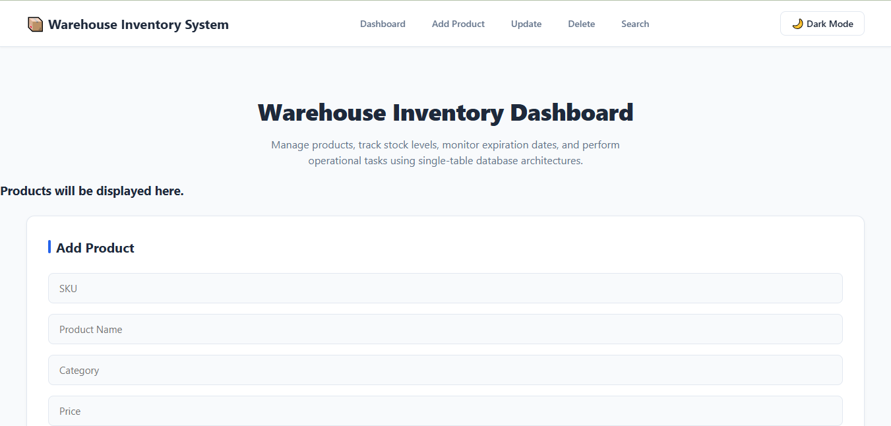
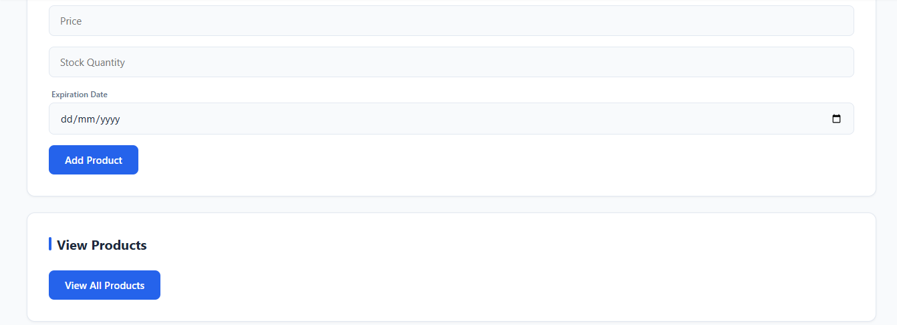
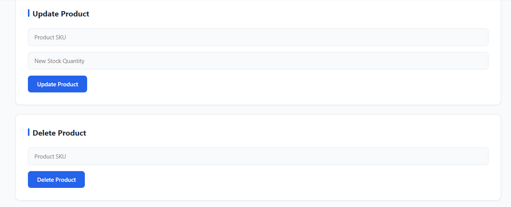
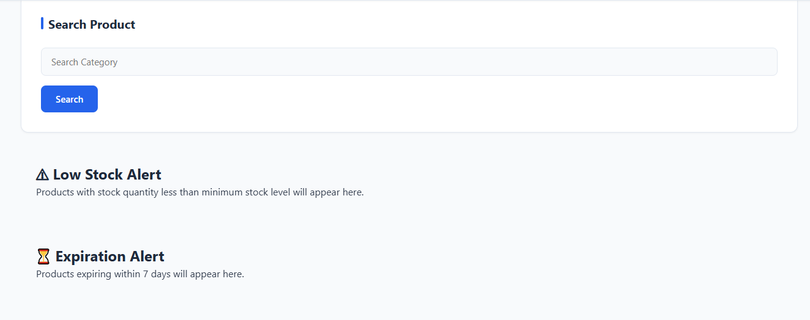

# 🛒 Supermarket Management System

Welcome to my **Supermarket Management System** project! This project is part of my web development learning journey. It aims to make supermarket operations easier, faster, and more organized.

---

## 📌 About the Project

The Supermarket Management System is designed to help manage supermarket activities, including product information, inventory, and sales. It provides a foundation for organizing supermarket data and improving daily business operations.

---

Features

- 📦 **Product Management:** Add, update, and manage product lists.
- 🗃️ **Inventory Management:** Track stock levels and item quantities.
- 💰 **Sales Management:** Record transactions and manage customer sales.
- 🔍 **Product Search:** Quickly locate items in the inventory.
- 📊 **Sales Reports:** View summary reports of daily transactions.
- 👥 **User Management:** Manage basic user roles and access.

---

## 🖼️ Project Screenshots

### 1. Main Dashboard / Overview

### 2. Product & Inventory Management

### 3. Sales & Transactions

### 4. Reports & Analytics

---

## 🛠️ Technologies Used

- **Backend:** Node.js, Express.js
- **Language:** JavaScript
- **Frontend:** HTML5, CSS3
- **Version Control:** Git, GitHub

├── package.json
├── package-lock.json
└── README.md
